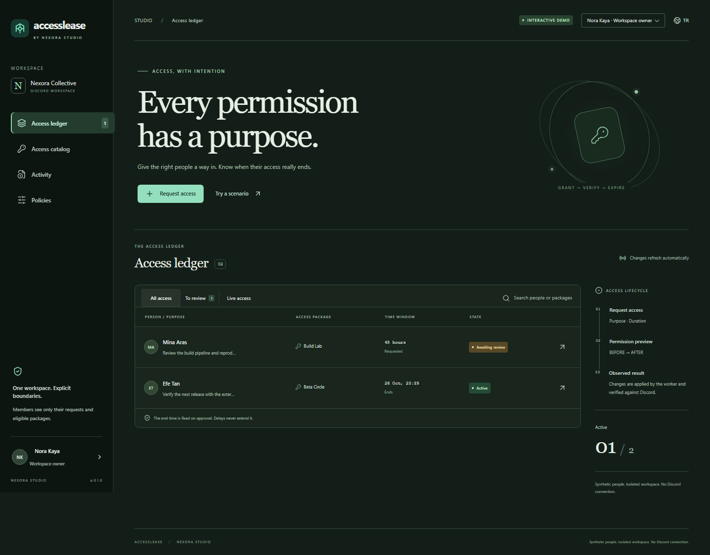

# AccessLease

**Bilinçli erişim. Doğrulanmış bitiş.**

Discord ekipleri için gerekçeli başvuru, ayrı kişi onayı, açıklanabilir izin önizlemesi ve doğrulanan süre sonu.

[English](README.md) · [Kurulum](docs/SETUP.tr.md) · [Mimari](docs/ARCHITECTURE.md) · [Güvenlik](SECURITY.md) · [Doğrulama durumu](docs/VALIDATION.md)



## Ne işe yarar?

Dışarıdan gelen bir geliştiriciye özel test kanalını iki günlüğüne açmak istiyorsun. AccessLease başvuruyu alır, yetkilinin hangi izinlerin açılacağını görmesini sağlar, onaydan sonra rolü verir ve süre sonunda kendi yönettiği rolü kaldırır.

Başka bir rol erişimi açık bırakıyorsa bunu da gösterir. **Rolün kaldırılmasıyla kanala erişimin kapanması ayrı sonuçlardır.**

## Temel özellikler

- Kanal görünürlüğü, yazma ve ses izinleri için önce/sonra karşılaştırması.
- Sunucu sahibi dahil herkes için ayrı bir onaylayıcı gereksinimi.
- Önceden var olan rolleri koruma; çakışan izinlerin sonuncusu bitene kadar rolü tutma.
- Yönetici müdahalesini ezmeden çakışma incelemesi.
- PostgreSQL üzerinde kalıcı işler, değişmeyen bitiş zamanı, yeniden deneme ve kesinti sonrası kontrol.
- Onay, işlem ve gözlenen sonuçlar için olay geçmişi; yetkili kullanıcıya dışa aktarım.
- Türkçe/İngilizce panel ve belgeler; Discord anahtarı gerektirmeyen, kişiye özel örnek demo.

## Hızlı başlangıç

Gerekenler: **Node.js 24**, npm ve **PostgreSQL 18 veya Docker Compose**.

```sh
npm ci
npm run setup
```

Kurulum özel `.env` dosyanı üretir. Desteklenen yerel PostgreSQL bulunursa yalnızca bu proje için, yerel bağlantı kabul eden ayrı bir geliştirme veritabanı açar. Bulunmazsa `docker compose up -d db` ile veritabanını başlat.

```sh
npm run build
npm start
```

**http://127.0.0.1:4348** adresini aç. İlk açılış **simülasyon** modundadır; gerçek Discord bağlantısı veya ücretli API çağrısı yapılmaz. Her tarayıcıya ayrı bir örnek alan oluşturulur.

Tam Docker kurulumu ve gerçek bot bağlantısı için [adım adım yönergeyi](docs/SETUP.tr.md) kullan. Yerel PostgreSQL seçeneğiyle Docker veritabanı seçeneklerinden birini seç.

## Demoda neler deneyebilirsin?

1. Nora olarak Mina’nın Build Lab başvurusunu incele ve onayla.
2. Rolün etkinleşmesini bekle; **Bir senaryo dene → 49 saat ileri git** seç.
3. Başvuruyu yeniden açıp gözlenen kapanışı incele.
4. Yeni bir gizli pencere aç. Mina’yı onaylamadan önce ikinci erişim senaryosunu uygula. Süre sonunda rol kalkar, ancak diğer izin nedeniyle metin kanalına erişim sürer.
5. Mina kullanıcısına geç: yalnızca kendi başvurularını görür, kendi erişimini onaylayamaz.

Kesinti senaryosu, simülatör bilinen durumunu gösterebilirken Discord rol işlemlerinin başarısız olmasını taklit eder; gerçek Discord kesinti ölçümü değildir.

## Doğrulama

```sh
npm run lint
npm run format:check
npm run check
npx playwright install chromium
npm run test:browser
```

Entegrasyon testleri gerçek PostgreSQL’de yalnızca kendilerine ait geçici şemaları oluşturup siler. İstersen `TEST_DATABASE_URL` ile ayrı, deneme amaçlı bir veritabanı seç.

İlk sürüm küçük, kendi sunucusunda çalışan ekipler için **alpha** niteliğindedir. Paket başına bir rol ve veritabanı başına bir etkin uygulama desteklenir. Standart metin/ses dışındaki kanal türleri, ödeme, genel moderasyon ve kanal kurallarını otomatik düzenleme kapsam dışıdır. Gerçek Discord testinin güncel durumu [doğrulama belgesinde](docs/VALIDATION.md) açıkça belirtilir.

Lisans [MIT](LICENSE). Ticari güvenlik botunun kaynakları ve kimlik bilgileri bu projede kullanılmaz.
